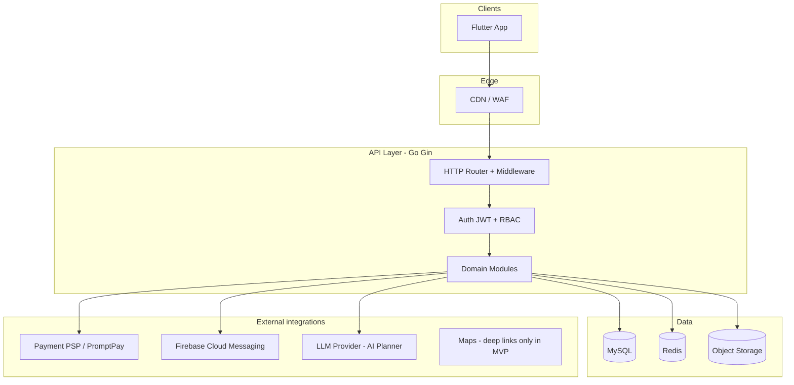
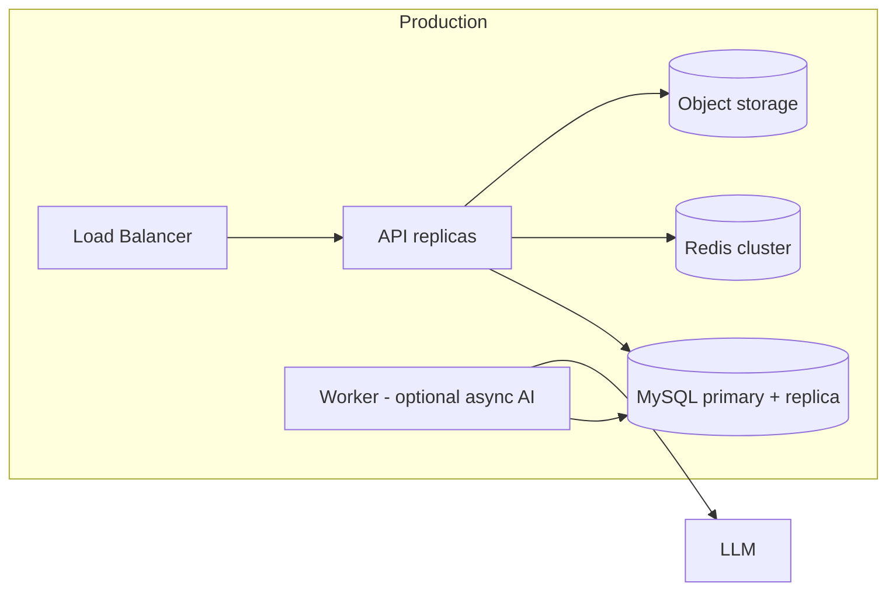

# System architecture — TEP / Sabai jai Travel

## Context

TEP is a Thailand-focused travel super-app: search and book stays, food, flights, and attractions; AI trip planning; Sabai Wallet; community (feed, Q&A, groups); profile, coupons, reviews, and support.

**Sources of truth**

- Business scope: derived from [sabai-travel-app-prototype.jsx](../../sabai-travel-app-prototype.jsx) (UX reference)
- API contract: [../api/openapi.yaml](../api/openapi.yaml)
- Data model: [../database/erd.md](../database/erd.md)

## Logical architecture



## Module boundaries (backend)

| Module | Responsibility |
|--------|----------------|
| `identity` | Register, login, refresh, password, account delete, guest session policy |
| `profile` | User profile, preferences, settings, notification prefs |
| `catalog` | Destinations, listings, search, filters, listing detail |
| `booking` | Cart-like booking draft, confirm, cancel, status, refunds rules |
| `payment` | Payment intents, PromptPay / card / wallet, webhooks |
| `wallet` | Balance, top-up, ledger (double-entry style transactions) |
| `trip` | Saved trips, itinerary storage, AI planner jobs |
| `community` | Posts, comments, groups, follow, moderation reports |
| `engagement` | Reviews, coupons, notifications |
| `support` | FAQ (static/CMS), support tickets |
| `media` | Presigned upload URLs, image metadata |
| `admin` | Moderation, coupon campaigns (future) |

Modules communicate in-process in MVP (monolith). Extract services only when scaling constraints are proven.

## Flutter client architecture

```
lib/
  app/                 # theme, router, env config
  core/                # api client, auth storage, errors, l10n
  features/            # one folder per domain module above
  shared/              # widgets matching design tokens
```

**API client modes** (configuration-driven):

- `mock` — in-app fixtures / mock server (DEV)
- `beta` — `BETA_API_BASE_URL`
- `production` — production base URL

No `if (mock)` inside business widgets; inject `Repository` interfaces.

## Cross-cutting concerns

| Concern | Approach |
|---------|----------|
| Auth | JWT access (short) + refresh token; refresh rotation in Redis |
| Authorization | RBAC: `traveler`, `local_guide` (future), `moderator`, `admin` |
| Idempotency | `Idempotency-Key` header on `POST /bookings`, `POST /payments/intents` |
| Pagination | Cursor-based for feeds; offset for admin lists |
| Errors | RFC 7807-style JSON problem details |
| Observability | Structured JSON logs, request ID, metrics (Prometheus), tracing (OpenTelemetry) |
| Rate limit | Redis token bucket per IP + per user |

## Deployment topology (target)



Beta mirrors production with separate secrets, database, and bucket prefix.

## ADRs

- [001 — Technology stack](adr/001-technology-stack.md)
- [002 — Mock-first delivery](adr/002-mock-first-delivery.md)
- [003 — Monolith-first backend](adr/003-monolith-first.md)

## Related

- [system-context.md](system-context.md)
- [integrations.md](integrations.md)
- [security-model.md](security-model.md)
- [environment-strategy.md](environment-strategy.md)
