# Entity-relationship model (MySQL)

Logical ERD aligned with prototype domains and [openapi.yaml](../api/openapi.yaml).

```mermaid
erDiagram
  users ||--o| user_profiles : has
  users ||--o{ user_sessions : has
  users ||--o| wallet_accounts : owns
  wallet_accounts ||--o{ wallet_transactions : logs
  users ||--o{ bookings : places
  bookings ||--o{ booking_line_items : contains
  bookings ||--o| payments : paid_by
  listings ||--o{ booking_line_items : references
  destinations ||--o{ listings : located_in
  users ||--o{ saved_trips : saves
  saved_trips ||--o{ trip_days : has
  trip_days ||--o{ trip_day_items : has
  users ||--o{ ai_planner_jobs : requests
  users ||--o{ reviews : writes
  listings ||--o{ reviews : receives
  users ||--o{ user_coupons : holds
  coupons ||--o{ user_coupons : issued_from
  users ||--o{ notifications : receives
  users ||--o{ support_tickets : opens
  users ||--o{ community_posts : authors
  community_posts ||--o{ community_comments : has
  community_groups ||--o{ community_posts : contains
  users ||--o{ community_group_members : joins
  users ||--o{ user_follows : follows
  users ||--o{ post_reports : reports
  users ||--o{ device_push_tokens : registers

  users {
    bigint id PK
    varchar email UK
    varchar phone UK
    varchar password_hash
    enum status
    datetime created_at
  }

  user_profiles {
    bigint user_id PK,FK
    varchar first_name
    varchar last_name
    enum gender
    date date_of_birth
    varchar nationality
    varchar language
    enum budget_level
    json travel_styles
    varchar favorite_destination
    enum travel_with
  }

  wallet_accounts {
    bigint id PK
    bigint user_id FK,UK
    decimal balance
    char currency
  }

  wallet_transactions {
    bigint id PK
    bigint wallet_id FK
    enum direction
    decimal amount
    varchar label
    varchar reference_type
    bigint reference_id
    datetime created_at
  }

  destinations {
    bigint id PK
    varchar slug UK
    varchar name_th
    text subtitle
    varchar gradient_css
  }

  listings {
    bigint id PK
    bigint destination_id FK
    enum type
    varchar name
    varchar location_text
    decimal rating_avg
    int review_count
    decimal price_from
    json amenities
    varchar hero_image_key
    enum status
  }

  bookings {
    bigint id PK
    varchar booking_number UK
    bigint user_id FK
    enum status
    decimal subtotal
    decimal service_fee
    decimal total
    varchar payment_method_label
    datetime booked_at
    datetime cancelled_at
    text cancel_reason
    decimal refund_amount
  }

  payments {
    bigint id PK
    bigint booking_id FK,UK
    enum method
    enum status
    varchar provider_ref
    decimal amount
    datetime confirmed_at
  }

  saved_trips {
    bigint id PK
    bigint user_id FK
    varchar destination_name
    int days
    int travelers
    decimal budget_total
    json budget_breakdown
    enum source
  }

  ai_planner_jobs {
    bigint id PK
    bigint user_id FK
    enum status
    json input
    json result
    datetime completed_at
  }

  community_posts {
    bigint id PK
    bigint author_id FK
    bigint group_id FK
    enum post_type
    varchar destination
    text body
    json shared_trip
    int like_count
    datetime created_at
  }

  community_comments {
    bigint id PK
    bigint post_id FK
    bigint author_id FK
    text body
    int like_count
    bool is_best_answer
  }

  coupons {
    bigint id PK
    varchar code UK
    varchar title
    decimal min_spend
    decimal max_discount
    date expires_on
  }

  user_coupons {
    bigint id PK
    bigint user_id FK
    bigint coupon_id FK
    enum status
  }
```

## Indexing notes

- `listings(destination_id, type, status)`, FULLTEXT on `name` + `location_text` (or external search later).
- `bookings(user_id, status, booked_at DESC)`.
- `community_posts(group_id, created_at DESC)`, `community_posts(author_id)`.
- `wallet_transactions(wallet_id, created_at DESC)`.

## Migration strategy

- Tool: golang-migrate or goose under `services/api-go/migrations/`.
- All DDL forward-only in repo; rollback scripts for ops emergencies documented separately.
- Seed data for DEV/BETA: destinations, listings mirror prototype constants.

See [data-dictionary.md](data-dictionary.md).
