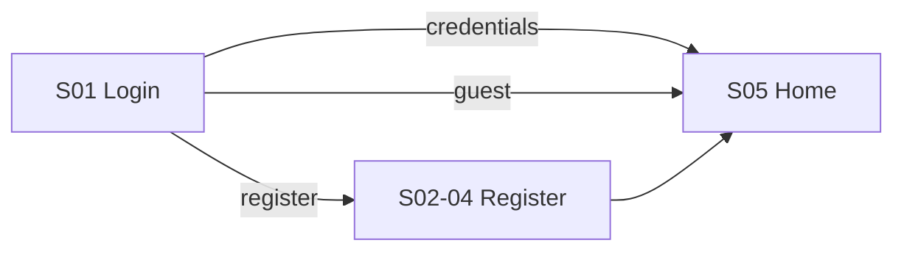
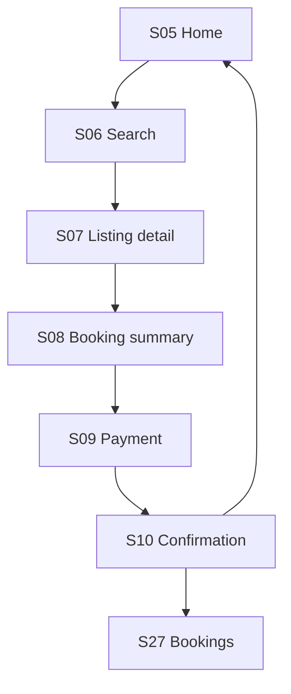
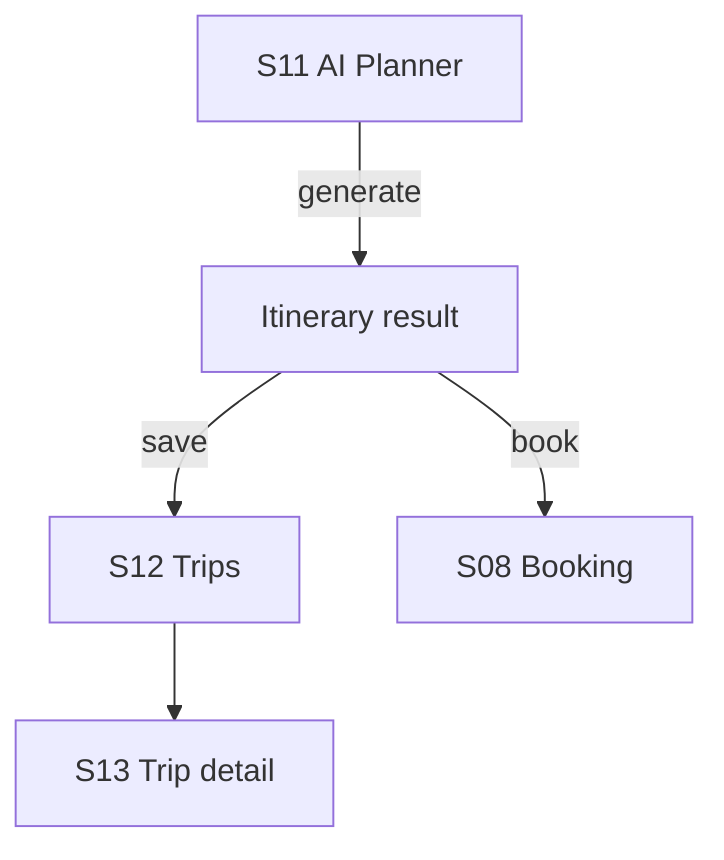
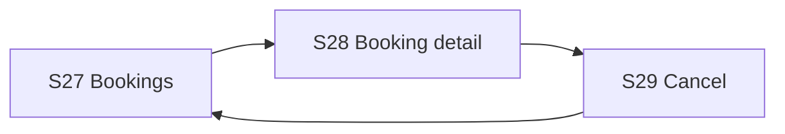
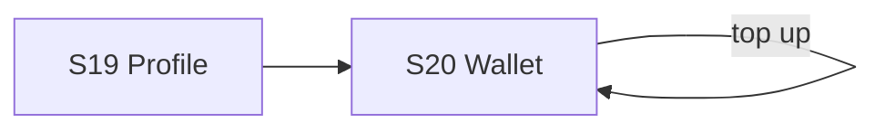
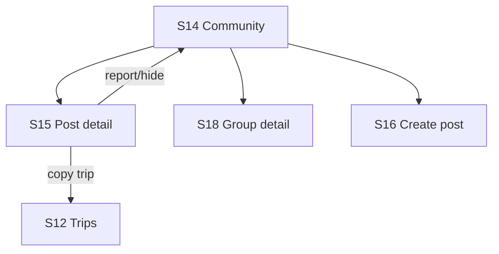
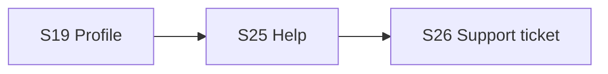
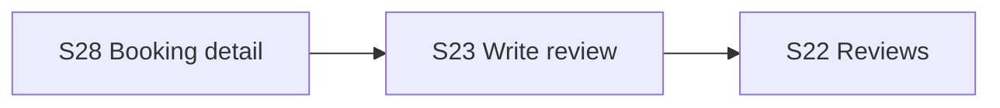

# User flows

Flows trace to screens in [screen-inventory.md](screen-inventory.md).

## UF-01 — Guest / login → home

**API:** `POST /auth/login` or register; guest = no token, catalog read-only until book.

## UF-02 — Search and book listing

**API sequence**

1. `GET /catalog/listings?q=&type=`
2. `GET /catalog/listings/{id}`
3. `POST /bookings` (+ optional coupon validation)
4. `POST /payments/intents` → poll or webhook
5. `GET /bookings/{id}`

**Edge cases:** wallet insufficient (REQ-PAY-02), coupon invalid, payment failed retry.

## UF-03 — AI planner → save → book trip package

**API**

1. `POST /ai/itineraries` → `202`
2. `GET /ai/itineraries/jobs/{id}` until completed
3. `POST /trips/saved`
4. Booking uses `tripPackage` on `POST /bookings`

## UF-04 — Cancel booking → wallet refund

**API:** `POST /bookings/{id}/cancel` → wallet credit + notifications.

## UF-05 — Wallet top-up

**API:** `POST /wallet/top-ups` (mock instant in DEV; QR flow in prod).

## UF-06 — Community: consume → engage → copy trip

**API:** feed, post detail, comments, like/save/follow/report, `POST .../copy-trip`.

## UF-07 — Support

**API:** `GET /support/faqs`, `POST /support/tickets`.

## UF-08 — Reviews after completed booking

**API:** `POST /reviews` linked to `listingId` from booking line item.

## Permission matrix (MVP)

| Action | Guest | Traveler |
|--------|-------|----------|
| Browse catalog | Yes | Yes |
| Book / pay | No | Yes |
| Wallet | No | Yes |
| Community post | No | Yes |
| Settings / delete account | No | Yes |

Server enforces; guest mode in prototype should map to read-only API in Flutter.
